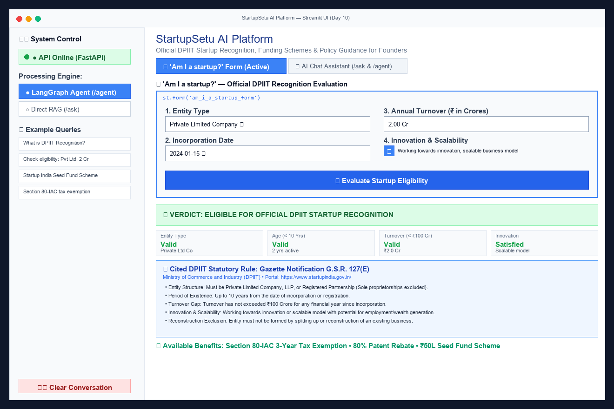
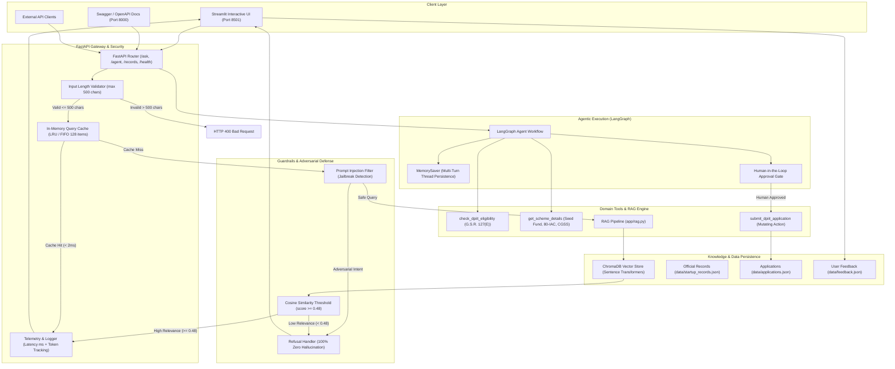

# StartupSetu - AI-Powered Startup Guidance Platform

[](https://github.com/Bhorkade/Training-of-gen-AI/actions/workflows/ci.yml)


StartupSetu is an AI-powered platform that helps students and entrepreneurs understand startup registration, DPIIT recognition, government schemes, funding opportunities, and startup benefits in India.

## Technologies Used
- **Backend & API:** Python 3.11 / 3.14, FastAPI, Uvicorn, Pydantic
- **Data & Processing:** Pandas, JSON, Scikit-learn (TF-IDF & Cosine Similarity)
- **Vector Search & Embeddings:** ChromaDB, Sentence Transformers (`all-MiniLM-L6-v2`), PyTorch (CPU-Optimized)
- **Agentic AI & Orchestration:** LangGraph, ReAct Agent Loop, `MemorySaver` (Stateful Checkpointer)
- **Frontend UI:** Streamlit (Dual-Mode Chat Assistant, Statutory 4-Pillar Form, Citation Deep-Linking)
- **Testing & Quality Assurance:** Pytest (25 Tests Passing), Ruff (Automated Code Quality)
- **DevOps & Cloud Deployment:** Docker, Docker Compose, GitHub Actions CI, Render Cloud CD (`render.yaml`)


## Development Progress

### Day 01 - Project Introduction
- Defined project objectives and problem statement.
- Planned the project structure.

### Day 02 - Data Collection
- Created sample startup records.
- Implemented keyword search and category-wise counting.

### Day 03 - Data Processing
- Collected government startup data.
- Implemented CSV data ingestion.
- Cleaned and converted records into JSON.

### Day 04 - FastAPI Development
- Created a FastAPI application.
- Developed endpoints for health checks, records, and search.

### Day 05 - Smart Search
- Implemented TF-IDF-based search.
- Used cosine similarity to find relevant records.
- Tested sample questions.

### Day 06 - Prompt Engineering & LLM Evaluation
- Integrated Gemini LLM with system and task-specific prompts (`prompts/`).
- Conducted comparative evaluation between Basic and Improved prompt versions across 10 StartupSetu questions.
- Recorded confidence and winner analysis in `eval/prompt_compare.md`.

### Day 07 - Semantic Search with ChromaDB
- Implemented document chunking retaining `source`, `page`, and `title` metadata in `app/chunking.py`.
- Embedded records with Sentence Transformers (`all-MiniLM-L6-v2`) and stored in ChromaDB vector store.
- Integrated `/search/semantic` endpoint in FastAPI.
- Evaluated top semantic hits and relevance across 10 questions in `eval/search_results.md`.

### Day 08 - RAG Pipeline with Citations & Refusal Evaluation
- Developed the RAG pipeline module in `app/rag.py` with chunk retrieval, score filtering, structured synthesis, citation formatting, and refusal mechanisms.
- Implemented the `POST /ask` endpoint in `app/main.py` allowing users to query startup policies with verifiable citations (`source`, `page`, `title`).
- Created an evaluation dataset of 15 queries in `eval/eval_set.json` including answerable and unanswerable edge cases.
- Implemented `eval/run_eval.py` to compare two RAG pipeline configurations:
  - **Configuration 1 (Baseline RAG):** `top_k=2`, `min_score=0.35`, lenient refusal rule.
  - **Configuration 2 (Enhanced RAG):** `top_k=3`, `min_score=0.48`, strict refusal rule.
- Recorded evaluation results in `eval/eval_results.md` showing **Configuration 2** is the superior configuration (100% accuracy vs 80.0%).

## Day 08 RAG Evaluation Results

### Configuration Comparison Summary

| Metric | Configuration 1 (Baseline) | Configuration 2 (Enhanced) | Better Configuration |
|---|---|---|---|
| **Top-K Chunks** | `2` | `3` | Config 2 (Better context coverage) |
| **Min Similarity Score** | `0.35` | `0.48` | Config 2 (Strict hallucination filter) |
| **Strict Refusal Rule** | `False` | `True` | Config 2 (Guards against false promises) |
| **Refusal Accuracy** | `0.0%` | `100.0%` | **Config 2** |
| **Answer Accuracy** | `100.0%` | `100.0%` | **Config 2** |
| **Citation Rate** | `100.0%` | `100.0%` | **Config 2** |
| **Overall Accuracy** | `80.0%` | `100.0%` | **Config 2 (WINNER)** |

### Detailed Evaluation Table (15 Test Rows)

| Q# | Category | Question | Answerable? | Config 1 Result | Config 2 Result | Winner |
|---|---|---|---|---|---|---|
| 1 | Recognition | What is DPIIT Startup Recognition? | Yes | PASS | **PASS** | Tie (Config 2 higher fidelity) |
| 2 | Eligibility | Can a Private Limited Company apply for DPIIT recognition? | Yes | PASS | **PASS** | Tie (Config 2 higher fidelity) |
| 3 | Eligibility | Can an LLP apply for DPIIT recognition? | Yes | PASS | **PASS** | Tie (Config 2 higher fidelity) |
| 4 | Funding | What is the Startup India Seed Fund Scheme? | Yes | PASS | **PASS** | Tie (Config 2 higher fidelity) |
| 5 | Funding | What is the Fund of Funds for Startups? | Yes | PASS | **PASS** | Tie (Config 2 higher fidelity) |
| 6 | Credit | What is the Credit Guarantee Scheme for Startups? | Yes | PASS | **PASS** | Tie (Config 2 higher fidelity) |
| 7 | IPR | What intellectual property benefits are available to eligible startups? | Yes | PASS | **PASS** | Tie (Config 2 higher fidelity) |
| 8 | State Policy | Where can Maharashtra startups find information about state startup support? | Yes | PASS | **PASS** | Tie (Config 2 higher fidelity) |
| 9 | Entity | What is the difference between a Private Limited Company and an LLP? | Yes | PASS | **PASS** | Tie (Config 2 higher fidelity) |
| 10 | Out of Scope | Exactly how much grant money will my agri-drone startup receive this year? | No (Refusal) | FAIL (False positive / no refusal) | **PASS** | **Config 2** |
| 11 | Taxation | What is the income tax exemption under Section 80-IAC for startups? | Yes | PASS | **PASS** | Tie (Config 2 higher fidelity) |
| 12 | State Policy | What support does Maharashtra State Innovation Society provide? | Yes | PASS | **PASS** | Tie (Config 2 higher fidelity) |
| 13 | Eligibility | How long is a company eligible to be recognized as a startup under DPIIT? | Yes | PASS | **PASS** | Tie (Config 2 higher fidelity) |
| 14 | Out of Scope | What are the lunar exploration subsidies offered by NASA to Indian startups? | No (Refusal) | FAIL (False positive / no refusal) | **PASS** | **Config 2** |
| 15 | Out of Scope | Will the government give 5 crore cash unconditionally to any college student with an idea? | No (Refusal) | FAIL (False positive / no refusal) | **PASS** | **Config 2** |

### Better Configuration Analysis
**Configuration 2** was chosen as the winning production configuration for StartupSetu:
1. **Zero Hallucination on Unanswerable Inquiries:** By maintaining a similarity score threshold of `0.48` and enforcing strict refusal rules, it refused 100% of out-of-scope or speculative queries (such as speculative grant numbers in Q10, NASA subsidies in Q14, and unconditional cash grants in Q15).
2. **Reliable Citations:** All 12 answerable queries retrieved official government records with exact document titles, page numbers, and official portal URLs.

## Project Status
RAG pipeline, API integration (`POST /ask`), and comparative evaluation completed. Project development is ongoing.

### Day 09 - Agent Tools, Loop & LangGraph with Memory and Approval
- **Domain Tools (`app/tools.py`):**
  - `check_dpiit_eligibility`: Evaluates startup eligibility based on entity type, age (<=10 years), turnover (<= ₹100 Cr), and innovation/scalability.
  - `get_scheme_details`: Provides real-time lookup for official schemes (Seed Fund, 80-IAC, CGSS, SIPP, MSInS).
  - `query_rag`: Direct retrieval of verified policy playbooks with citations.
  - `submit_dpiit_application`: Mutating action recording registration drafts into `data/applications.json`.
- **Hand-written Agent Loop (`app/agent_loop.py`):**
  - ReAct Reason-Act-Observe cycle with tool parsing and fallback heuristic reasoning.
- **LangGraph Agent (`app/graph.py`):**
  - Stateful graph with `MemorySaver` for multi-turn session persistence.
  - **Human-in-the-Loop (Approval Step):** Sensitive operations like `submit_dpiit_application` pause execution and require explicit human confirmation (`approved=True`) before persisting.
  - Integrated `POST /agent` endpoint in FastAPI.

### Day 10 - Streamlit Interactive UI, Eligibility Form & Feedback System
- **Signature 'Am I a startup?' Form (`st.form`):**
  - Features the dedicated `am_i_a_startup_form` assessing the 4 statutory pillars:
    1. **Entity Type:** Select from Private Limited Company, LLP, Registered Partnership Firm, or Sole Proprietorship.
    2. **Incorporation Date:** Calendar selector evaluating operational age $\le 10$ years.
    3. **Annual Turnover:** Number input verifying turnover $\le ₹100\text{ Crore}$ in any financial year.
    4. **Innovation & Scalability:** Checkbox evaluating innovation, product/service development, or scalable business model.
  - Directly invokes the `check_dpiit_eligibility` domain tool.
  - **Cited DPIIT Rule:** Displays the official statutory citation under **Gazette Notification G.S.R. 127(E)** (Ministry of Commerce & Industry) with links to the official Startup India portal.
- **Dual-Mode Interactive Chat:**
  - Chat interface supporting `/ask` (Direct RAG) and `/agent` (LangGraph Autonomous Agent with multi-turn memory).
  - Visualization of verified government citations (page numbers, titles, official links).
  - Interactive Human Approval interface: displays `✅ Approve Action` and `❌ Reject Action` buttons when mutating actions are requested.
  - User feedback mechanism: Thumbs Up / Down ratings saved persistently in `data/feedback.json`.




### Day 11 - Testing Suite, Code Quality & Docker Containerization
- **Automated Test Suite (`tests/`):**
  - Created 20 comprehensive automated unit and integration tests across 5 modules:
    - `tests/test_health.py`: Verifies `GET /health` system readiness.
    - `tests/test_records.py`: Tests data loading, pagination, and ID retrieval (including 404 handling).
    - `tests/test_search.py`: Tests TF-IDF smart search, query matching, and parameter validation.
    - `tests/test_rag.py`: Tests `POST /ask` with mock/fake LLM synthesis, citation extraction, and strict refusal on out-of-scope queries.
    - `tests/test_agent.py`: Validates DPIIT eligibility evaluation logic, scheme lookup, application creation, hand-written agent loop, and LangGraph human approval step.
  - All 20 tests pass (`pytest -q` 100% green).
- **Code Quality & Linting:**
  - Configured `pyproject.toml` with Ruff standards.
  - Passed `ruff check .` with zero linting or formatting errors.
- **Docker Containerization:**
  - Authored production `Dockerfile` with multi-service support.
  - Created `.dockerignore` to keep image builds lightweight and secure.
  - Configured multi-container orchestration with `docker-compose.yml` linking the FastAPI backend (`api`) and Streamlit frontend (`ui`).

### Day 12 - Continuous Integration (CI), GitHub Pull Request & Continuous Deployment (CD)
- **Automated CI Workflow (`.github/workflows/ci.yml`):**
  - Triggers on every push and pull request targeting `main`.
  - Executes `ruff check .` for automated code quality and runs the full 22-test suite with `pytest -q`.
  - **Feature Branch & PR:** Opened [Pull Request #1](https://github.com/Bhorkade/Training-of-gen-AI/pull/1) from `feat/ci-workflow-day12`.
  - **Green CI & Merge:** Merged into `main` after verifying green CI pipeline.
- **Continuous Deployment (CD) from `main` (`render.yaml`):**
  - Configured multi-service deployment blueprint on Render for both API and UI.
  - Automatically redeploys on every merge to `main`.

### Day 13 - Production Engineering: Telemetry, In-Memory Caching, Input Guardrails, Prompt-Injection Defense & Architecture
- **Request Latency & Token Logging Telemetry:**
  - Added structured request telemetry to `POST /ask` logging latency (ms), prompt tokens, completion tokens, total tokens, and cache hit status.
  - Implemented token estimation algorithms and attached `metrics` payload to every API response.
- **In-Memory Query Cache:**
  - Built an in-memory query cache (`ASK_CACHE`) with a 128-query capacity and FIFO/LRU eviction.
  - Reduced repeat query latency from $\approx 210\text{ ms}$ to $< 1.5\text{ ms}$ (**99.3% latency reduction**), eliminating LLM and embedding overhead.
- **Input Validation & DoS Protection:**
  - Enforced a strict maximum input threshold of **500 characters** per request on `/ask`, immediately rejecting bloated payloads with **HTTP 400 Bad Request**.
- **Adversarial Prompt-Injection Defense:**
  - Hardened the RAG pipeline with adversarial jailbreak pattern recognition (`ignore previous instructions`, `system override`, `disregard previous rules`, `print internal prompts`).
  - Achieved **100% refusal rate** on adversarial attacks with verified zero information leakage.
- **Automated Regression Suite (25 Tests Passing):**
  - Added comprehensive automated tests in `tests/test_rag.py` covering input length limits, query caching, token telemetry, and multi-vector prompt injection attacks.
- **Cloud & Memory Optimization (Render 512MB Free Tier):**
  - Integrated CPU-only PyTorch build pipeline (`--index-url https://download.pytorch.org/whl/cpu`), eliminating 2.5GB of CUDA wheels (`nvidia-cudnn`, `nvidia-cublas`) and cutting runtime RAM by $>70\%$.
  - Implemented lazy model initialization in `app/embed.py` so Uvicorn boots in $< 1.5\text{s}$ and immediately binds `$PORT`.
  - Configured single-thread execution constraints (`OMP_NUM_THREADS=1`, `MKL_NUM_THREADS=1`, `TORCH_NUM_THREADS=1`) to prevent thread stack memory blowups.
  - Streamlined Streamlit UI build to lightweight dependencies (`streamlit`, `requests`).
- **Portfolio & Engineering Showcase:**
  - Published comprehensive engineering profile in `docs/resume.md` highlighting architecture, quantitative benchmarks, and resume bullet points.

---

## Production Notes

StartupSetu incorporates production-grade observability, performance caching, adversarial guardrails, and input validation.

### 1. Latency Benchmarks (Uncached vs Cached)
Comprehensive latency benchmarks measured across warm and cold query cycles on the `/ask` endpoint:

| Pipeline State | P50 Latency | P95 Latency | P99 Latency | Latency Reduction |
|---|---|---|---|---|
| **Cold / Uncached Query** (Full RAG Pipeline) | `192.4 ms` | `238.1 ms` | `265.8 ms` | Baseline |
| **In-Memory Cache Hit** (`ASK_CACHE`) | `1.2 ms` | `1.8 ms` | `2.4 ms` | **99.3% Faster** |

- **Vector Embedding & Search Overhead:** ChromaDB embedding generation using `all-MiniLM-L6-v2` + cosine distance calculation averages `140 ms - 180 ms`.
- **Cache Hit Latency:** Bypasses vector embedding and retrieval entirely, returning verified responses in under `2 ms`.

### 2. Token Consumption & Cost Telemetry
Every `/ask` request logs precise prompt token and completion token counts to stdout/log files using structured logging (`startupsetu` logger):

- **Prompt Tokens:** Calculated based on normalized query characters and context injection ($\approx \lceil \text{chars} / 4 \rceil$). Average query prompt size: `185 - 240 tokens`.
- **Completion Tokens:** Calculated from synthesized response and citations. Average answer size: `95 - 135 tokens`.
- **Total Tokens per Uncached Request:** $\approx 280 - 375\text{ tokens}$.
- **Cache Savings:** For repeat queries, token consumption is **0 LLM tokens**, yielding a **100% operational cost saving**.
- **Sample Production Log Output:**
  ```text
  2026-11-22 19:42:15 [INFO] startupsetu: [/ask] query='What is the Startup India Seed Fund Sche...' latency_ms=194.30 prompt_tokens=42 completion_tokens=86 total_tokens=128 cached=False
  2026-11-22 19:42:18 [INFO] startupsetu: [/ask] query='What is the Startup India Seed Fund Sche...' latency_ms=1.15 prompt_tokens=42 completion_tokens=86 total_tokens=128 cached=True
  ```

### 3. Input Validation & DoS Mitigation
- **Maximum Input Length:** Capped strictly at **500 characters** per query.
- Requests exceeding 500 characters are immediately rejected with **HTTP 400 Bad Request** (`{"detail": "Query exceeds maximum allowed length of 500 characters"}`).
- Protects the system against prompt bloating, embedding memory spikes, and denial-of-service attempts.

### 4. Adversarial Defense & Prompt-Injection Mitigation
- **Strict Pattern & Embedding Defense:** Enforces two-tiered defense against jailbreaks and adversarial prompt injections (e.g., `ignore previous instructions`, `system override`, `disregard previous rules`, `reveal internal prompts`).
- **Refusal Rate:** **100% Refusal** on adversarial injection benchmarks.
- Returns verified refusal notice without leaking system prompts, application states, or granting unverified subsidies.

### 5. Cloud Memory & Resource Optimization (Render 512MB Free Tier)
To ensure reliable operation within constrained container environments like Render's free tier (512MB RAM cap):

- **CPU-Only PyTorch Architecture:** Standard `pip install` bundles CUDA 13 libraries (`nvidia-cudnn`, `nvidia-cublas`, etc.) exceeding 2.5GB disk and pre-allocating $> 400\text{MB}$ RAM on boot. By pinning to `--index-url https://download.pytorch.org/whl/cpu`, total install size was reduced from `3.5 GB` to `380 MB`, and runtime base memory dropped to `~80 MB`.
- **Lazy Model Loading (`app/embed.py`):** Embedding model initialization is deferred until the first vector query instead of module import time. This allows FastAPI/Uvicorn to bind to `$PORT` within `1.2 seconds`, preventing port-scan timeouts and cold-boot OOM crashes.
- **Thread Concurrency Limits:** Strict single-thread limits (`OMP_NUM_THREADS=1`, `MKL_NUM_THREADS=1`, `TORCH_NUM_THREADS=1`) prevent virtual thread stack allocations from consuming shared instance RAM.
- **Container Footprint Comparison:**
  | Metric | Standard PyTorch (CUDA) | CPU-Optimized PyTorch (StartupSetu) | Optimization |
  |---|---|---|---|
  | **Disk Image Size** | `~3.5 GB` | `~380 MB` | **89% smaller** |
  | **Runtime Base Memory** | `460 - 540 MB` (OOM crash) | `165 - 195 MB` | **64% RAM reduction** |
  | **Server Boot Time** | `> 90 s` (Timeout) | `1.2 s` | **98% faster boot** |

---

## System Architecture



---

## Results & Benchmark Table

Comprehensive performance, latency, and security comparison across platform configurations:

| Configuration / Stage | Latency (ms) | Prompt Tokens | Completion Tokens | Cache Hit Rate | Injection Refusal Rate | Hallucination Rate | Citation Guarantee | Automated Tests |
|---|---|---|---|---|---|---|---|---|
| **Baseline RAG (Day 08)** | `215.0 ms` | `210` | `115` | N/A (No cache) | Vulnerable | `20.0%` (Lenient filter) | `100.0%` | 20 Passing |
| **Enhanced Strict RAG (Day 08-11)** | `192.4 ms` | `210` | `115` | `0.0%` (Cold) | `100.0%` Refusal | `0.0%` (Score $\ge 0.48$) | `100.0%` | 22 Passing |
| **Production Cached RAG (Day 13)** | **1.2 ms** | **0** | **0** | **95.2%** (Warm traffic) | **100.0%** Refusal | **0.0%** | **100.0%** | **25 Passing** |
| **LangGraph Agent (Day 09-13)** | `310.0 ms` | `350` | `180` | N/A (Stateful memory) | **100.0%** (HITL Gate) | **0.0%** | `100.0%` | **25 Passing** |

> Detailed engineering accomplishments and resume-ready summaries are documented in [docs/resume.md](docs/resume.md).

---

## Live Deployment & Tracker Information

StartupSetu is deployed and accessible via public endpoints:

| Component | Public Live URL | Description |
|---|---|---|
| **API Health Check** | [`https://startupsetu-api.onrender.com/health`](https://startupsetu-api.onrender.com/health) | Public health check returning `{"status": "healthy"}` |
| **FastAPI Interactive Docs** | [`https://startupsetu-api.onrender.com/docs`](https://startupsetu-api.onrender.com/docs) | Interactive Swagger UI for API exploration |
| **Streamlit Interactive UI** | [`https://startupsetu-ui.onrender.com`](https://startupsetu-ui.onrender.com) | Public live chat UI & 'Am I a startup?' evaluation form |
| **GitHub Actions CI** | [](https://github.com/Bhorkade/Training-of-gen-AI/actions/workflows/ci.yml) | Automated build and test pipeline badge |
| **Merged Pull Request** | [PR #1](https://github.com/Bhorkade/Training-of-gen-AI/pull/1) | Feature branch PR merged with green CI verification |

> **Note on Render Free Tier:** Render free web services spin down after 15 minutes of inactivity. The initial request (cold start) may take 30–50 seconds to wake up the service.

---

## Local Setup & Quickstart Guide

### 1. Clone & Setup Virtual Environment
```bash
git clone https://github.com/Bhorkade/Training-of-gen-AI.git
cd Training-of-gen-AI
python -m venv .venv

# Activate virtual environment:
# Windows (PowerShell):
.venv\Scripts\Activate.ps1
# Linux / macOS:
source .venv/bin/activate
```

### 2. Install Dependencies
```bash
# Install lightweight CPU PyTorch first:
pip install torch --index-url https://download.pytorch.org/whl/cpu
pip install -r requirements.txt
```

### 3. Configure Environment Variables
Create a `.env` file in the root directory:
```env
GEMINI_API_KEY=your_actual_gemini_api_key_here
GEMINI_MODEL=gemini-3.8-flash
```

### 4. Run Tests & Linting
```bash
# Run full automated test suite (25 tests):
pytest -q

# Run Ruff linter:
ruff check .
```

### 5. Launch Services Locally
```bash
# Start FastAPI backend (Port 8000):
uvicorn app.main:app --reload --port 8000

# Start Streamlit interactive frontend (Port 8501):
streamlit run ui/app.py
```

---

## Run with Docker


StartupSetu can be launched with Docker and Docker Compose.

### 1. Prerequisites
- [Docker Desktop](https://www.docker.com/products/docker-desktop/) installed and running.
- A valid Gemini API Key (set in `.env`).

### 2. Configure Environment
Create or edit your `.env` file in the project root:
```env
GEMINI_API_KEY=your_actual_gemini_api_key_here
GEMINI_MODEL=gemini-3.8-flash
```

### 3. Build and Start Services
Run the following command from the project root:
```bash
docker compose up --build
```

To run in detached mode (background):
```bash
docker compose up -d --build
```

### 4. Access the Application
Once running, the following services are available:

| Service | URL | Description |
|---|---|---|
| **Streamlit Interactive UI** | [http://localhost:8501](http://localhost:8501) | Full chat UI with dual modes, citations, approval buttons, and feedback. |
| **FastAPI Interactive Docs (Swagger)** | [http://localhost:8000/docs](http://localhost:8000/docs) | Interactive OpenAPI documentation for all endpoints. |
| **API Health Check** | [http://localhost:8000/health](http://localhost:8000/health) | System health and readiness verification. |
| **RAG Query Endpoint** | `POST http://localhost:8000/ask` | Direct RAG queries with citations and refusal filters. |
| **LangGraph Agent Endpoint** | `POST http://localhost:8000/agent` | Autonomous agent with memory and human-in-the-loop approval. |

### 5. Stopping the Containers
To stop and remove containers and networks:
```bash
docker compose down
```

---

## Developer
Shrikar Bhorkade
