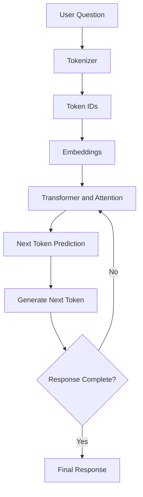

# How Large Language Models (LLMs) Work

## 1. What is an LLM?

A Large Language Model (LLM) is an AI model trained on a large amount of text data. It learns patterns in language and uses those patterns to generate human-like responses.

An LLM predicts the next token based on the previous tokens.

A token can be a complete word, part of a word, or punctuation.

## 2. How does an LLM work?

The basic process is:

1. User enters a question.
2. Tokenizer converts the text into tokens.
3. Tokens are converted into numerical representations.
4. Transformer processes the information using attention.
5. The model predicts the next token.
6. Tokens are generated one by one.
7. The final response is displayed to the user.

## 3. LLM Architecture Diagram

## 4. Important concepts

### Tokenization
Breaking text into smaller pieces called tokens.

### Embeddings
Converting tokens into numerical vectors.

### Transformer
A neural network architecture that processes text and context.

### Attention
Helps the model understand which parts of the input are important to other parts.

### Logits
Raw numerical scores produced by the model for possible next tokens.

### Softmax
Converts logits into probability values.

### Temperature
Controls randomness in token selection. Lower temperature generally produces more predictable outputs.

## 5. How does an LLM learn?

During training, the model receives text examples and learns to predict tokens.

It calculates the prediction error using a loss function. The model's weights are adjusted to reduce this error.

This process is repeated many times.

## 6. What is RAG?

RAG means Retrieval-Augmented Generation.

It combines information retrieval with an LLM.

StartupSetu can use RAG to:
1. Receive a startup founder's question.
2. Search its dataset.
3. Retrieve relevant records.
4. Give those records to an LLM as context.
5. Generate an answer based on the retrieved information.
6. Show the source of the information.

## 7. Limitations of LLMs

- LLMs can generate incorrect information.
- They may not know the latest government policies.
- They can misunderstand unclear questions.
- They can generate hallucinations.
- They cannot answer accurately when required information is missing.

## 8. How StartupSetu uses LLM concepts

StartupSetu helps startup founders understand DPIIT recognition, startup schemes, eligibility and related information.

The system should retrieve information from its available records and use that information as context for generating answers.

If the dataset does not contain the answer, StartupSetu should clearly say that the information is unavailable instead of guessing.

## 9. Conclusion

LLMs generate text by predicting the next token using patterns learned during training. They are useful for answering questions, but their responses should be checked against reliable sources.

StartupSetu should use its dataset and official sources to provide reliable information to startup founders.