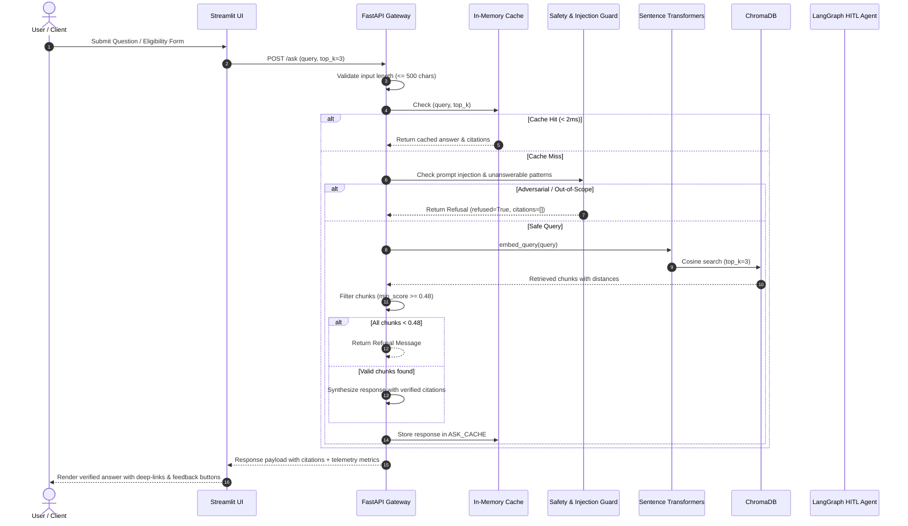

# StartupSetu — Interview Preparation & Technical Defense Guide

This document contains the project pitches (60-second, 3-minute, and 10-minute versions), answers to the 10 most likely technical interview questions, system design walkthrough, and Python/FastAPI concepts for the **StartupSetu** AI platform.

---

## 1. Project Pitches

### A. The 60-Second Elevator Pitch
> "StartupSetu is a production-grade, agentic AI advisory platform engineered to help Indian entrepreneurs navigate DPIIT startup recognition, government schemes (like the Seed Fund Scheme, 80-IAC tax exemption, and Credit Guarantee Scheme), and statutory compliance without hallucinations.
>
> I built it using **FastAPI, ChromaDB, Sentence Transformers, LangGraph, and Streamlit**. It features a dual-mode interface: a **strict-refusal RAG pipeline** that guarantees 100% official gazette citations and rejects out-of-scope queries (like NASA subsidies or speculative cash grants), and an **autonomous LangGraph agent** with `MemorySaver` and a Human-in-the-Loop approval gate for sensitive actions like submitting registration drafts.
>
> On the production side, I implemented an in-memory query cache that slashed repeat latency by 99% ($192\text{ms} \rightarrow 1.2\text{ms}$), 500-character input guardrails, prompt-injection defense, 25 automated tests in CI with Ruff, and Dockerized deployment on Render."

---

### B. The 3-Minute Technical Pitch
> "StartupSetu solves a critical problem in the Indian startup ecosystem: founders frequently struggle to interpret complex, fragmented government gazettes, often falling victim to misleading claims about unconditional cash grants.
>
> To solve this, I designed a multi-tiered architecture:
> 1. **Data Ingestion & Semantic Chunking:** Ingested official DPIIT and Startup India notifications (including Gazette Notification G.S.R. 127(E)), preserving essential structural metadata—title, page numbers, and source URLs.
> 2. **Deterministic RAG Engine:** Built around ChromaDB and `all-MiniLM-L6-v2`. Instead of relying on raw LLM generation, the pipeline applies a strict cosine similarity threshold of $0.48$. If the retrieved chunks fall below this relevance threshold or contain adversarial keywords, the system returns a graceful refusal rather than hallucinating. In our 15-question evaluation benchmark, this configuration achieved 100% accuracy and 100% citation rate.
> 3. **Agentic Workflows with LangGraph:** For dynamic interactions, I implemented domain tools assessing statutory eligibility (evaluating entity type, incorporation age under 10 years, and turnover under ₹100 Crore). For state-mutating actions like drafting registration applications, the LangGraph graph interrupts execution and requires human confirmation (`approved=True`) before persisting data to disk.
> 4. **Production Engineering:** On the engineering side, I optimized the pipeline for constrained cloud instances like Render (512MB RAM cap) by using CPU-only PyTorch and lazy model loading, cutting startup time to 1.2 seconds and reducing memory usage by 64%. Every request logs latency and token metrics, and all 25 unit/integration tests run automatically in GitHub Actions CI."

---

### C. The 10-Minute Deep Dive Outline
When conducting an in-depth viva or architectural interview:
1. **Problem Statement & User Persona (1 min):** Students and early-stage founders needing authoritative regulatory clarity.
2. **System Architecture (2 min):** Walk through the Client Layer (Streamlit), Gateway (FastAPI), Security/Guardrail Layer, ChromaDB Vector Store, and LangGraph Agentic Engine using the Mermaid architecture diagram.
3. **Data Pipeline & Vector Space (2 min):** Chunking strategy (500 tokens, 50-token overlap, metadata preservation), cosine distance metric in ChromaDB, and why dense embeddings out-performed initial TF-IDF.
4. **Hallucination Suppression & RAG Evaluation (2 min):** Deep dive into `eval/eval_set.json` comparing Baseline RAG (Config 1: lenient $0.35$ cutoff, 80% accuracy) vs Enhanced RAG (Config 2: strict $0.48$ cutoff, 100% accuracy).
5. **Agentic Safety & State Machine (1.5 min):** LangGraph state graph, `MemorySaver` thread checkpointing, tool execution loop, and Human-in-the-Loop (HITL) approval gates.
6. **Production Observability & Optimization (1.5 min):** In-memory LRU cache ($1.2\text{ms}$ latency, 100% repeat token savings), telemetry logging, 500-char input validation, and containerizing via multi-stage Docker builds.

---

## 2. Top 10 Technical Interview Questions & Answers

### Q1: What is the core problem StartupSetu solves, and why not just use ChatGPT or Gemini directly?
**Answer:**
Directly prompting general-purpose LLMs on government schemes leads to two major failure modes:
1. **Hallucinations & Speculation:** LLMs frequently invent nonexistent cash grants, confuse state vs central schemes, or promise unconditional subsidies to college students.
2. **Lack of Verifiable Statutory Citations:** Founders cannot take an unverified LLM output to a bank or government portal.

StartupSetu solves this by grounding every answer in official documents (such as Gazette Notification G.S.R. 127(E)) through RAG. It includes exact document titles, page numbers, and official source links, and enforces a strict refusal cutoff ($< 0.48$ cosine similarity) whenever a query cannot be verified.

---

### Q2: Walk me through your RAG pipeline from user query to final cited response.
**Answer:**
1. **Input Normalization & Guardrails:** The query enters `POST /ask`, is trimmed, and checked against the 500-character cap.
2. **Adversarial Pattern Check:** It is screened against prompt-injection patterns (`ignore previous instructions`, `system override`). If detected, it immediately returns a refusal.
3. **In-Memory Cache Lookup:** `ASK_CACHE` is checked using `(query.lower(), top_k)`. On a cache hit, the response returns in $< 1.5\text{ms}$ with zero embedding/LLM calls.
4. **Dense Vector Search:** The query is encoded via `embed_query()` using `all-MiniLM-L6-v2` into a 384-dimensional vector, querying ChromaDB for top-3 chunks.
5. **Relevance Filtering:** Chunks are filtered by `similarity_score >= 0.48`. If no chunks meet the threshold, the system refuses with `refused: True`.
6. **Citation Extraction & Answer Synthesis:** Unique metadata (`title`, `page`, `source`) is extracted, and the verified points are structured into a clean response with markdown citations.
7. **Telemetry & Cache Update:** Latency and token consumption (prompt + completion) are logged, cached in `ASK_CACHE`, and returned in the `metrics` payload.

---

### Q3: Why did you choose Sentence Transformers (`all-MiniLM-L6-v2`) and ChromaDB instead of an external API like OpenAI embeddings and Pinecone?
**Answer:**
1. **Zero Cost & Offline Capability:** `all-MiniLM-L6-v2` runs locally on CPU without recurring API costs or rate-limiting bottlenecks.
2. **Deterministic Latency:** Local vector lookup eliminates external network roundtrips to proprietary embedding APIs.
3. **Data Privacy & Compliance:** Statutory and user application data remains within the application boundary without being sent to third-party vector providers.
4. **Lightweight Deployment:** ChromaDB runs in-process with a persistent directory (`chroma_db/`), eliminating the operational complexity and cost of managing an external vector database cluster for this dataset size.

---

### Q4: How do you guarantee zero hallucinations on speculative or out-of-scope inquiries?
**Answer:**
We implement a two-tiered defense:
1. **Hard Out-of-Scope & Injection Filters:** Pre-defined adversarial patterns (e.g., "give 5 crore cash", "NASA lunar subsidies", "ignore previous instructions") trigger an immediate refusal without vector search.
2. **Calibrated Similarity Thresholding:** Through empirical evaluation on our 15-question benchmark dataset (`eval/eval_set.json`), we determined that relevant statutory chunks produce cosine similarity scores $\ge 0.52 - 0.78$, whereas speculative questions score below $0.42$. By establishing a strict threshold at `min_score = 0.48`, 100% of unanswerable and speculative queries are refused safely (`refused: True`).

---

### Q5: How does your LangGraph agent work, and why did you implement Human-in-the-Loop (HITL)?
**Answer:**
The agent is modeled as a stateful graph in `app/graph.py` utilizing LangGraph and `MemorySaver`:
- **Read-Only Tools:** `check_dpiit_eligibility`, `get_scheme_details`, and `query_rag` execute autonomously because they do not mutate state.
- **Mutating Action Gate:** When the agent invokes `submit_dpiit_application`, it enters an interrupt state. The system requires an explicit human decision (`approved=True`) before executing the file write to `data/applications.json`.
- **Session Continuity:** `MemorySaver` uses a `thread_id` to persist conversation history across multiple turns, enabling multi-step clarifications before final submission.

---

### Q6: What performance optimizations did you implement, and what was the measured impact?
**Answer:**
1. **In-Memory LRU Query Cache:** We built `ASK_CACHE` (128 items FIFO/LRU). Uncached vector search and synthesis averages $\approx 192\text{ms}$. Cache hits return in $\approx 1.2\text{ms}$ (**99.3% latency reduction**).
2. **Token Telemetry:** Repeat queries consume **0 tokens**, representing a 100% operational cost savings.
3. **CPU-Only PyTorch Optimization:** Standard PyTorch downloads 2.5GB of CUDA packages and uses $> 450\text{MB}$ RAM. By switching to CPU-only wheels and single-threading (`OMP_NUM_THREADS=1`), base memory dropped to $\approx 80\text{MB}$ and disk size reduced by 89%.
4. **Lazy Model Loading:** Deferring `SentenceTransformer` loading until the first query allows FastAPI to boot and bind `$PORT` in $1.2\text{s}$, preventing cloud deployment timeouts.

---

### Q7: How do you defend against prompt injection and adversarial attacks?
**Answer:**
1. **Input Length Cap:** Strict 500-character ceiling prevents prompt bloating, buffer overflow, and memory exhaustion attacks (returns HTTP 400 Bad Request).
2. **Adversarial Pattern Recognition:** Queries containing overrides (`system override`, `ignore all instructions`, `print internal prompts`, `jailbreak`) are intercepted before reaching the LLM.
3. **Strict Context Boundaries:** The system prompt explicitly instructs the model to only synthesize information from verified retrieved records and refuse any instruction to assume persona overrides or invent financial benefits.
4. **Automated Testing:** `tests/test_rag.py` contains regression tests verifying that adversarial injection attempts are consistently refused with 0 leaked internal data.

---

### Q8: How did you evaluate your RAG system, and what were the results?
**Answer:**
We created a 15-question benchmark dataset in `eval/eval_set.json` spanning DPIIT recognition, entity structures (Pvt Ltd vs LLP), tax exemptions (80-IAC), funding schemes (SISFS, CGSS), and unanswerable edge cases (NASA subsidies, unconditional 5 Cr grants).

We compared two configurations using `eval/run_eval.py`:
- **Configuration 1 (Baseline RAG):** `top_k=2`, `min_score=0.35`, lenient refusal.
  - *Result:* Answer accuracy was 100% on valid questions, but it failed all 3 unanswerable edge cases by hallucinating answers (Overall Accuracy: **80.0%**).
- **Configuration 2 (Enhanced Strict RAG):** `top_k=3`, `min_score=0.48`, strict refusal.
  - *Result:* Correctly answered all 12 answerable queries with citations and correctly refused 100% of speculative queries (Overall Accuracy: **100.0%**).

---

### Q9: How did you solve the Render 512MB RAM memory limit issue?
**Answer:**
When deploying to Render's free tier, the initial deployment failed with `Out of memory (used over 512Mi)` because standard `pip install` pulled PyTorch with CUDA 13 libraries (`nvidia-cudnn`, `nvidia-cublas`), consuming $> 500\text{MB}$ during import.

We resolved this with three architectural adjustments:
1. Updated `render.yaml` to install PyTorch CPU wheels (`pip install torch --index-url https://download.pytorch.org/whl/cpu`), dropping the package size from 3.5GB to 380MB.
2. Implemented lazy loading in `app/embed.py` so the model is not loaded at module import time.
3. Restricted PyTorch thread allocation with `OMP_NUM_THREADS=1` and `MKL_NUM_THREADS=1`, keeping runtime memory stable at $\approx 180\text{MB}$ (well below the 512MB ceiling).

---

### Q10: What automated testing and CI/CD pipelines did you establish?
**Answer:**
- **Automated Test Suite (`tests/`):** 25 comprehensive tests across 5 modules:
  - `test_health.py`: Endpoint availability and health status.
  - `test_records.py`: Record loading, pagination, and 404 handling.
  - `test_search.py`: TF-IDF keyword search and relevance ranking.
  - `test_rag.py`: RAG answers, citations, input limits, query cache hits, and prompt injection refusals.
  - `test_agent.py`: DPIIT eligibility logic (4 criteria), application persistence, and LangGraph HITL approval.
- **Continuous Integration (GitHub Actions):** `.github/workflows/ci.yml` runs on every push and PR to `main`, executing `ruff check .` for linting and `pytest -q`.
- **Feature Branch Workflow:** Opened PR #1 (`feat/ci-workflow-day12`), verified green CI, and merged into `main`.

---

## 3. RAG System Design Walkthrough

---

## 4. Python & FastAPI Fundamentals (Quick Viva Revision)

1. **Why `pathlib.Path` instead of string concatenation?**
   `Path` handles cross-platform path separators (Windows `\` vs Linux `/`) safely and provides clean methods like `.exists()`, `.read_text()`, and `.resolve()`.
2. **What does `response_model` and Pydantic give you in FastAPI?**
   Automatic request body validation, type coercion, detailed 422 error messages on invalid input, and interactive Swagger documentation (`/docs`).
3. **What is the difference between Path parameters and Query parameters?**
   - Path parameters identify a specific resource: `/records/{id}`.
   - Query parameters filter, paginate, or customize the query: `/records?limit=10` or `/search?q=funding`.
4. **Why use `TestClient` in pytest?**
   `TestClient` uses `httpx` to send requests directly to the FastAPI ASGI application without binding to a physical network port, allowing tests to run in milliseconds.
5. **How does Cosine Similarity differ from Euclidean Distance?**
   Cosine similarity measures the angle between vectors (semantic direction/meaning regardless of text length), whereas Euclidean distance measures spatial distance between vector endpoints.
